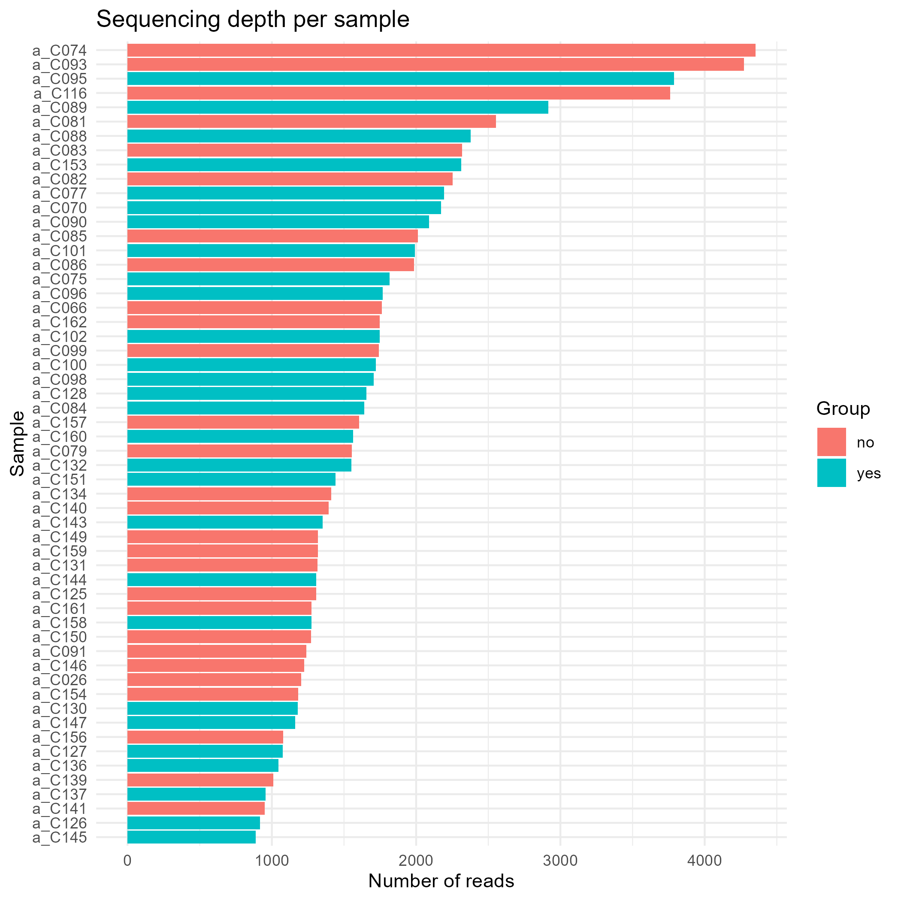
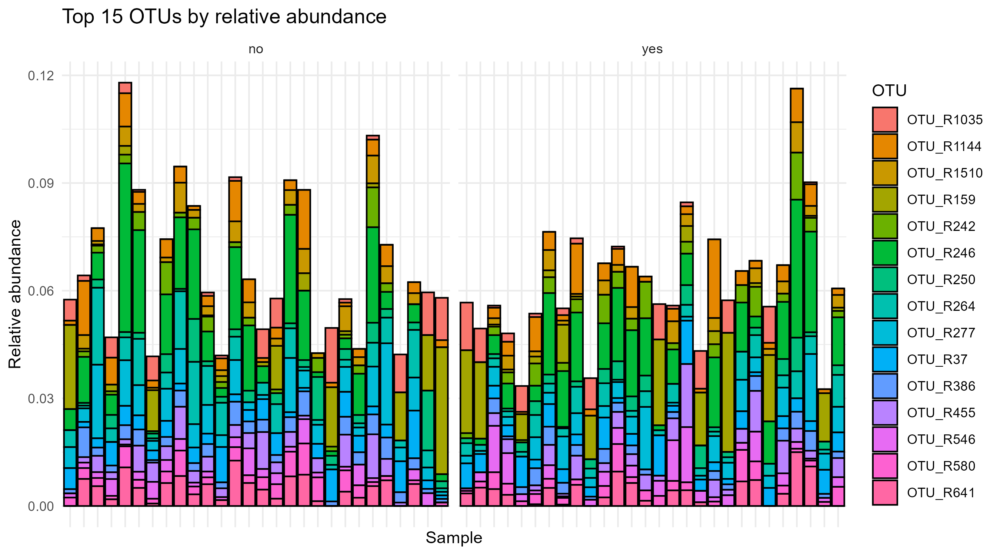
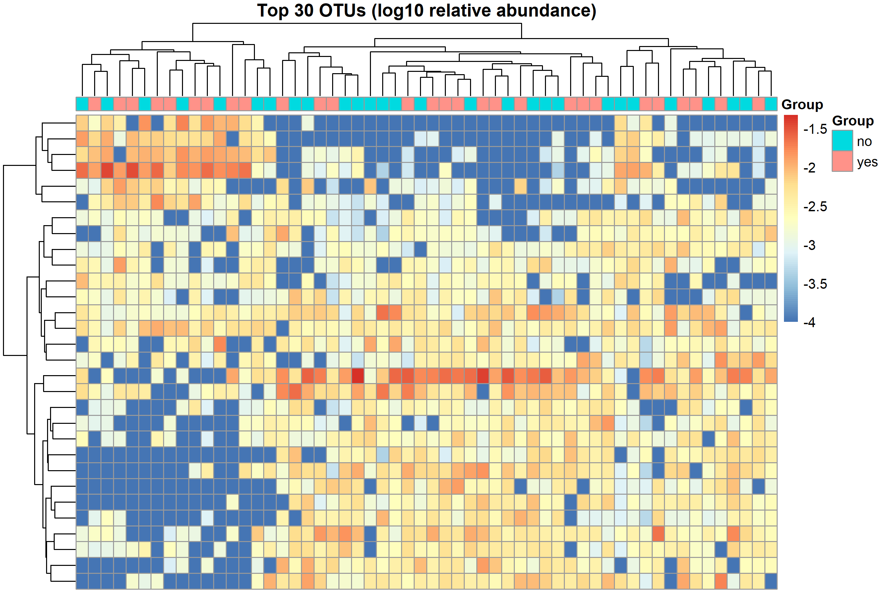
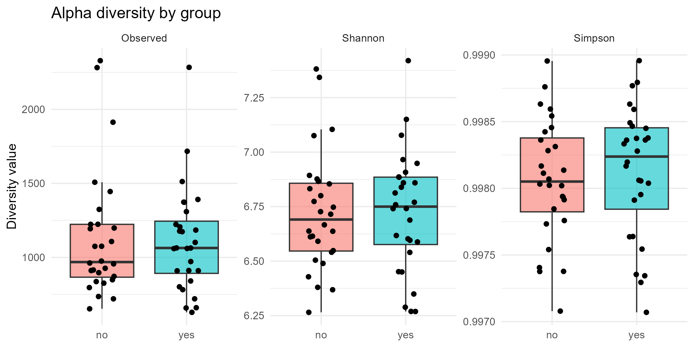
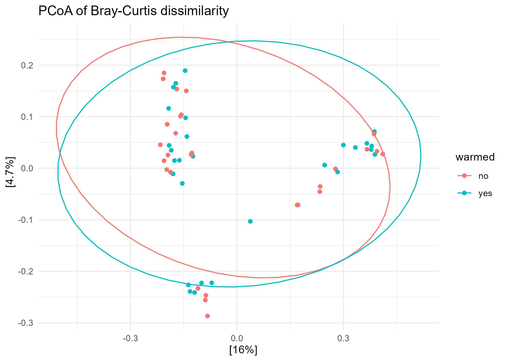
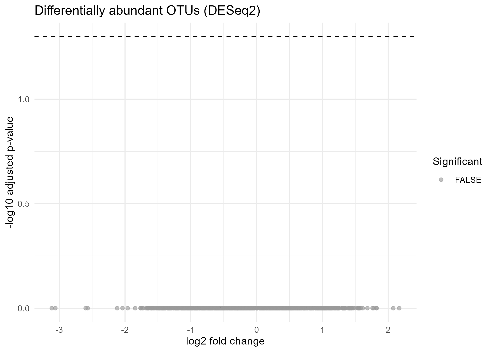

# Effect of Experimental Warming on Soil Bacterial Communities

**Student registration number:** 2021/ASP/32
**Module:** Bioinformatics – ICA3 (2026)

---

## 1. Abstract

Soil microbes support nutrient cycling and crop growth, and climate warming may alter their communities. We analysed 16S rRNA OTU count data from 56 sequenced soil samples (technical replicates of 24 communities) from a long-term warming and clipping experiment. Using R, we compared alpha diversity, Bray-Curtis community composition (PCoA, PERMANOVA) and OTU abundance (DESeq2) between warmed and non-warmed soil. Warming did not significantly change alpha diversity (Shannon p = 0.73) or community composition (PERMANOVA R² = 0.018, p = 0.32), and no OTU differed significantly in abundance after FDR correction. These results provide no evidence that warming altered soil bacterial communities in this dataset, although replication is limited and the replicates are not fully independent.

## 2. Introduction

Soil microorganisms drive nutrient cycling, organic matter decomposition and plant health, so they are central to agriculture and food security (Fierer, 2017). Rising temperatures linked to climate change may alter which bacteria live in soil and how diverse these communities are, with possible feedbacks on soil carbon storage (Bardgett, Freeman and Ostle, 2008). If warming shifts the microbial community, it could affect soil fertility and crop productivity.

Studying this question with 16S rRNA amplicon sequencing is practical, because the data are public and a standard bioinformatics workflow can compare communities between conditions. This project re-analyses a published soil dataset from a long-term global change experiment in which plots were warmed, clipped (aboveground biomass removed), or both (Zhou et al., 2011).

**Aim:** To test whether experimental warming changes the diversity and composition of soil bacterial communities.

**Hypotheses:**
- H1: Alpha diversity (richness and Shannon diversity) differs between warmed and non-warmed soil.
- H2: Overall community composition (beta diversity) differs between warmed and non-warmed soil.
- H3: Some OTUs differ significantly in abundance between warmed and non-warmed soil.

## 3. Data

- **Source:** the `soilrep` example dataset distributed with the Bioconductor package *phyloseq* (McMurdie and Holmes, 2013). The data come from Zhou et al. (2011), who supplied the raw files to the phyloseq authors. The dataset is distributed inside the phyloseq package and is used here under that package's licence.
- **Files used:** `data/soilrep_otu_counts.csv` (OTU count table) and `data/soilrep_sample_metadata.csv` (sample information). They were exported from the phyloseq object without modification.
- **Size:** 56 sequenced samples × 16,825 OTUs; 98,022 reads in total; 889–4,352 reads per sample (median 1,558; mean 1,750).
- **Structure:** the 56 samples are technical replicates (1–3 barcoded sequencing runs each) of 24 soil communities, identified by the `Sample` column.
- **Variables:** `warmed` (no / yes; 28 samples each), `clipped` (no / yes; 28 each) and `Treatment` (UC, UU, WC, WU; 14 samples each, the combination of the two). The main grouping variable in this report is `warmed`.
- **Limitation of the data:** the dataset has no taxonomic annotation, so OTUs cannot be assigned to phyla or genera.
- **Ethics:** public, non-human environmental data; no ethical restrictions.

## 4. Methods

All analysis was done in R inside one R Markdown file (`code/analysis.Rmd`).

1. **Import and quality control.** The CSV files were read into a *phyloseq* object. Sequencing depth per sample was inspected. OTUs with 5 or fewer reads in total were removed to reduce noise (16,825 → 3,853 OTUs); no sample was removed. Counts were converted to relative abundances for composition, heatmap and beta-diversity analysis. Each of the 56 sequenced samples was analysed as one observation.
2. **Exploratory analysis.** Bar plots of the most abundant OTUs and a heatmap of the top 30 OTUs (*pheatmap*) were used to look for patterns and outliers.
3. **Alpha diversity.** Observed OTUs, Shannon and Simpson indices were calculated on unfiltered counts with `estimate_richness()` and compared between groups with the Kruskal-Wallis test (equivalent to the Wilcoxon rank-sum test for two groups), a non-parametric choice that does not assume normality. P-values were adjusted with Benjamini-Hochberg.
4. **Beta diversity.** Bray-Curtis dissimilarity was visualised with PCoA. Differences between groups were tested with PERMANOVA (`adonis2`, *vegan*, 999 permutations). Homogeneity of dispersion was checked with `betadisper`, since PERMANOVA can be misleading when group spread differs.
5. **Differential abundance.** *DESeq2* was applied to raw counts with `poscounts` size factors, which suit sparse microbiome data. Warmed vs non-warmed soil was compared and OTUs with FDR < 0.05 were considered significant.

Packages: *phyloseq*, *DESeq2*, *vegan*, *tidyverse* (ggplot2, dplyr), *pheatmap*.

## 5. Results

### 5.1 Data quality and composition



*Figure 1. Reads per sample, coloured by warming treatment.* Depth ranged from 889 to 4,352 reads per sample, with a similar range in both groups (median 1,402 in non-warmed and 1,647 in warmed samples).



*Figure 2. Relative abundance of the 15 most abundant OTUs.* The most abundant OTU (OTU_R246) had a mean relative abundance of only about 1.1%, and the 15 most abundant OTUs together made up about 6.5%, so the communities were highly diverse and not dominated by a few OTUs.



*Figure 3. Heatmap of the 30 most abundant OTUs, annotated by warming.* Samples formed several clusters, but warmed and non-warmed samples were interspersed within them, so there was no clear clustering by warming treatment.

### 5.2 Alpha diversity



*Figure 4. Observed OTUs, Shannon and Simpson indices by warming.*

| Measure | p-value | Adjusted p |
|---|---|---|
| Observed | 0.928 | 0.928 |
| Shannon | 0.731 | 0.928 |
| Simpson | 0.491 | 0.928 |

Alpha diversity did not differ significantly between warmed and non-warmed soil for any of the three measures (all adjusted p = 0.928), so H1 is not supported.

### 5.3 Beta diversity



*Figure 5. PCoA of Bray-Curtis dissimilarity, with 90% ellipses per group. The first two axes explain 16% and 4.7% of the variation.*

The ellipses of warmed and non-warmed samples overlap almost completely. PERMANOVA confirmed this: warming explained only 1.8% of the variation in community composition (R² = 0.018, F = 1.01, p = 0.324). The dispersion test showed that group spread was similar (F = 0.058, p = 0.810), so the PERMANOVA assumption was met. H2 is not supported. The clusters visible along the first axis therefore do not correspond to warming; they may reflect other sources of variation, such as differences between plots, which were not examined here.

### 5.4 Differential abundance



*Figure 6. DESeq2 results for warmed vs non-warmed soil. Red points would have FDR < 0.05.*

Of the 3,846 OTUs tested after DESeq2's independent filtering, 30 had a nominal p < 0.05, but none was significant at FDR < 0.05 (smallest adjusted p = 0.999), so no points in Figure 6 are red. H3 is not supported.

## 6. Discussion

Our analysis asked whether warming changes soil bacterial communities. The alpha-diversity result (Section 5.2) indicates that warming did not change within-community diversity, and the PERMANOVA result (Section 5.3) indicates that overall composition did not differ. At the OTU level, no individual OTU responded to warming after FDR correction, which is consistent with the community-level results. These findings differ from Zhou et al. (2011), whose statistical analyses reported differences in community composition and structure between warming and non-warming and between clipping and non-clipping. Possible reasons include their additional preprocessing (removal of singleton sequences and less-representative OTUs), different statistical methods, and the limited replication in our analysis. A non-significant result is not proof that there is no effect; it means that any effect was too small to detect with these data.

**Limitations.** First, the 56 samples are technical replicates of only 24 communities, but our tests treated each sequenced sample as independent (pseudoreplication). This can make p-values too small, so a significant result would have needed cautious interpretation; because no significant effect was found, the main conclusion (no detectable effect) is not undermined by this problem, but the true number of independent units is only 12 communities per group, so statistical power is lower than 28 vs 28 suggests. Second, the source study was designed to evaluate the reproducibility of amplicon sequencing and found that technical replicates shared only a small fraction of their OTUs (Zhou et al., 2011), which adds noise, particularly to beta-diversity estimates. Third, the data have no taxonomy, so OTUs cannot be named or linked to function. Fourth, 16S counts are relative, not absolute, abundances, and OTU tables depend on clustering choices. Fifth, an association between warming and community change would not prove a mechanism. Sixth, thousands of OTUs were tested, so false positives are possible despite FDR control. Finally, warming and clipping may interact (see the `Treatment` variable), which this analysis did not model.

**Real-world implications.** If warming shifts soil bacterial communities, the effects could reach nutrient cycling and soil carbon storage, which matter for crop productivity under climate change. In this dataset, however, we found no evidence of such a shift. Because of the limitations above, the results should be read as exploratory and need confirmation with more independent plots and taxonomically annotated data.

## 7. Conclusion and future work

This project tested whether experimental warming alters soil bacterial diversity and composition using public 16S data analysed in R. In this dataset, experimental warming had no detectable effect on soil bacterial alpha diversity, community composition or individual OTU abundance. Future work could account for the replicate structure (for example by pooling technical replicates or using a model with community as a random effect), assign taxonomy to the OTUs, model the warming × clipping interaction, add shotgun metagenomics to study function, use time-series data, and repeat the analysis on independent soil datasets.

## 8. Reproducibility

1. Install R (≥ 4.2) and RStudio. The analysis was run with R 4.6.2 on Windows 11.
2. Clone or download this repository.
3. Install packages (once):
   ```r
   if (!require("BiocManager")) install.packages("BiocManager")
   BiocManager::install(c("phyloseq", "DESeq2"))
   install.packages(c("tidyverse", "vegan", "pheatmap", "rmarkdown"))
   ```
4. Open `code/analysis.Rmd` in RStudio and click **Knit → Knit to HTML**. This produces `code/analysis.html`, all figures in `figures/` and tables in `results/`.
5. A random seed (`set.seed(123)`) is set for reproducibility.

**Package versions:** R 4.6.2; phyloseq 1.56.0; DESeq2 1.52.0; vegan 2.7-6; tidyverse 2.0.0 (ggplot2 4.0.3, dplyr 1.2.1); pheatmap 1.0.13. The full `sessionInfo()` output is at the end of `code/analysis.html`.

```
Repository structure
├── README.md
├── code/analysis.Rmd, analysis.html
├── data/  (two CSV files)
├── figures/
└── results/
```

## 9. References

Bardgett, R.D., Freeman, C. and Ostle, N.J. (2008) 'Microbial contributions to climate change through carbon cycle feedbacks', *The ISME Journal*, 2(8), pp. 805–814.

Fierer, N. (2017) 'Embracing the unknown: disentangling the complexities of the soil microbiome', *Nature Reviews Microbiology*, 15(10), pp. 579–590.

Kolde, R. (no date) *pheatmap: Pretty Heatmaps*. R package.

Love, M.I., Huber, W. and Anders, S. (2014) 'Moderated estimation of fold change and dispersion for RNA-seq data with DESeq2', *Genome Biology*, 15, p. 550.

McMurdie, P.J. and Holmes, S. (2013) 'phyloseq: an R package for reproducible interactive analysis and graphics of microbiome census data', *PLoS ONE*, 8(4), e61217.

Oksanen, J. et al. (no date) *vegan: Community Ecology Package*. R package.

Wickham, H. (2016) *ggplot2: Elegant Graphics for Data Analysis*. New York: Springer.

Zhou, J., Wu, L., Deng, Y., Zhi, X., Jiang, Y.-H., Tu, Q., Xie, J. et al. (2011) 'Reproducibility and quantitation of amplicon sequencing-based detection', *The ISME Journal*, 5(8), pp. 1303–1313. doi:10.1038/ismej.2011.11. (Dataset: `soilrep`, distributed with phyloseq.)
