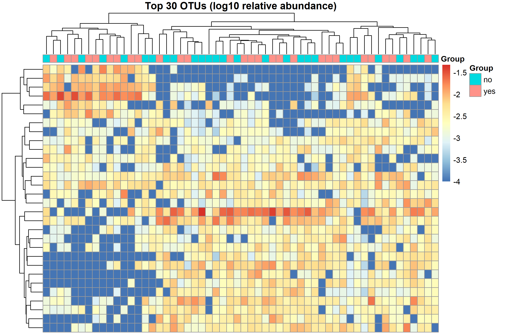

```{r setup, include=FALSE}
knitr::opts_chunk$set(echo = TRUE, warning = FALSE, message = FALSE,
                      fig.width = 7, fig.height = 5, dpi = 150)
set.seed(123)                       # reproducibility
dir.create("../figures", showWarnings = FALSE)
dir.create("../results", showWarnings = FALSE)
```

# 0. Packages

```{r packages}
# Install once (uncomment if needed):
# if (!require("BiocManager")) install.packages("BiocManager")
# BiocManager::install(c("phyloseq", "DESeq2"))
# install.packages(c("tidyverse", "vegan", "pheatmap"))

library(phyloseq)
library(DESeq2)
library(vegan)
library(tidyverse)
library(pheatmap)
```

# 1. Data import

```{r import}
# Read the two CSV files stored in the repository's data/ folder
otu  <- read.csv("../data/soilrep_otu_counts.csv", row.names = 1, check.names = FALSE)
meta <- read.csv("../data/soilrep_sample_metadata.csv", row.names = 1,
                 stringsAsFactors = TRUE)

# Make sure samples are in the same order in both tables
stopifnot(all(colnames(otu) == rownames(meta)))

# Build a phyloseq object (OTUs are rows)
soilrep <- phyloseq(otu_table(as.matrix(otu), taxa_are_rows = TRUE),
                    sample_data(meta))
soilrep

# Metadata variables
sample_variables(soilrep)
head(data.frame(sample_data(soilrep)))
```

```{r variables}
group_var <- "warmed"          # main variable: warmed (no / yes). Other options: "clipped", "Treatment"
table(sample_data(soilrep)[[group_var]])
```

# 2. Quality control and cleaning

```{r qc}
# Sequencing depth per sample
depth <- data.frame(Sample = sample_names(soilrep),
                    Reads  = sample_sums(soilrep),
                    Group  = sample_data(soilrep)[[group_var]])

p_depth <- ggplot(depth, aes(x = reorder(Sample, Reads), y = Reads, fill = Group)) +
  geom_col() + coord_flip() +
  labs(title = "Sequencing depth per sample", x = "Sample", y = "Number of reads") +
  theme_minimal()
p_depth
ggsave("../figures/fig1_depth.png", p_depth, width = 7, height = 7)

summary(depth$Reads)

# Remove very rare OTUs (<= 5 reads in total) and empty samples
ps <- prune_taxa(taxa_sums(soilrep) > 5, soilrep)
ps <- prune_samples(sample_sums(ps) > 0, ps)

cat("OTUs before:", ntaxa(soilrep), " after:", ntaxa(ps), "\n")
cat("Samples before:", nsamples(soilrep), " after:", nsamples(ps), "\n")

# Relative-abundance version (for beta diversity / plots)
ps_rel <- transform_sample_counts(ps, function(x) x / sum(x))
```

# 3. Exploratory data analysis

## 3.1 Community composition (phylum level)

```{r composition}
# soilrep has no taxonomy table, so check before using taxonomy
has_tax <- !is.null(tax_table(ps_rel, errorIfNULL = FALSE))
has_tax

if (has_tax) {
  # Phylum-level composition
  ps_phylum <- tax_glom(ps_rel, taxrank = "Phylum", NArm = TRUE)
  top10 <- names(sort(taxa_sums(ps_phylum), decreasing = TRUE))[1:10]
  ps_top <- prune_taxa(top10, ps_phylum)
  p_comp <- plot_bar(ps_top, fill = "Phylum") +
    facet_wrap(as.formula(paste("~", group_var)), scales = "free_x") +
    labs(title = "Top 10 phyla by relative abundance", y = "Relative abundance") +
    theme_minimal() + theme(axis.text.x = element_blank())
} else {
  # No taxonomy: show the 15 most abundant OTUs instead
  top15 <- names(sort(taxa_sums(ps_rel), decreasing = TRUE))[1:15]
  ps_top <- prune_taxa(top15, ps_rel)
  p_comp <- plot_bar(ps_top, fill = "OTU") +
    facet_wrap(as.formula(paste("~", group_var)), scales = "free_x") +
    labs(title = "Top 15 OTUs by relative abundance", y = "Relative abundance") +
    theme_minimal() + theme(axis.text.x = element_blank())
}
p_comp
ggsave("../figures/fig2_composition.png", p_comp, width = 9, height = 5)
```

## 3.2 Sample clustering heatmap (top 30 OTUs)

```{r heatmap}
top30 <- names(sort(taxa_sums(ps_rel), decreasing = TRUE))[1:30]
mat <- as(otu_table(prune_taxa(top30, ps_rel)), "matrix")
if (!taxa_are_rows(ps_rel)) mat <- t(mat)

annot <- data.frame(Group = sample_data(ps_rel)[[group_var]])
rownames(annot) <- sample_names(ps_rel)

pheatmap(log10(mat + 1e-4), annotation_col = annot,
         show_colnames = FALSE, show_rownames = FALSE,
         main = "Top 30 OTUs (log10 relative abundance)",
         filename = "../figures/fig3_heatmap.png", width = 9, height = 6)
# Show the saved figure in the report

```

# 4. Main analysis

## 4.1 Alpha diversity

```{r alpha}
# Use raw (unpruned) counts, as recommended for richness estimators
alpha <- estimate_richness(soilrep, measures = c("Observed", "Shannon", "Simpson"))
alpha$Group <- sample_data(soilrep)[[group_var]]
alpha$Sample <- rownames(alpha)

alpha_long <- alpha %>%
  pivot_longer(c(Observed, Shannon, Simpson), names_to = "Measure", values_to = "Value")

p_alpha <- ggplot(alpha_long, aes(x = Group, y = Value, fill = Group)) +
  geom_boxplot(alpha = 0.6, outlier.shape = NA) +
  geom_jitter(width = 0.15, size = 1.5) +
  facet_wrap(~Measure, scales = "free_y") +
  labs(title = "Alpha diversity by group", x = NULL, y = "Diversity value") +
  theme_minimal() + theme(legend.position = "none")
p_alpha
ggsave("../figures/fig4_alpha.png", p_alpha, width = 8, height = 4)

# Kruskal-Wallis test: non-parametric, works for 2 or more groups
# (with exactly 2 groups it is equivalent to the Wilcoxon rank-sum test)
alpha_tests <- alpha_long %>%
  group_by(Measure) %>%
  summarise(p_value = kruskal.test(Value ~ factor(Group))$p.value, .groups = "drop") %>%
  mutate(p_adj = p.adjust(p_value, method = "BH"))
alpha_tests
write.csv(alpha_tests, "../results/alpha_tests.csv", row.names = FALSE)
```

## 4.2 Beta diversity (Bray-Curtis, PCoA, PERMANOVA)

```{r beta}
# phyloseq:: prefix needed, because IRanges (loaded with DESeq2) also has a 'distance' function
bray <- phyloseq::distance(ps_rel, method = "bray")
ord  <- ordinate(ps_rel, method = "PCoA", distance = bray)

p_pcoa <- plot_ordination(ps_rel, ord, color = group_var) +
  stat_ellipse(level = 0.9) +
  labs(title = "PCoA of Bray-Curtis dissimilarity") +
  theme_minimal()
p_pcoa
ggsave("../figures/fig5_pcoa.png", p_pcoa, width = 7, height = 5)

# PERMANOVA: do group centroids differ?
meta <- data.frame(sample_data(ps_rel))
perm <- adonis2(bray ~ meta[[group_var]], permutations = 999)
perm

# PERMANOVA assumes similar dispersion between groups -> check
disp <- betadisper(bray, meta[[group_var]])
anova(disp)
```

## 4.3 Differential abundance (DESeq2)

```{r deseq}
# Convert phyloseq -> DESeq2 (raw counts, pruned OTUs)
dds <- phyloseq_to_deseq2(ps, as.formula(paste("~", group_var)))

# 'poscounts' size factors handle the many zeros in microbiome data
dds <- estimateSizeFactors(dds, type = "poscounts")
dds <- DESeq(dds, fitType = "local")

# With more than 2 groups DESeq2 needs to know WHICH two to compare.
# By default: 2nd level vs 1st level. Change these two lines if you want another pair.
lev <- levels(factor(sample_data(ps)[[group_var]]))
print(lev)
reference  <- lev[1]
comparison <- lev[2]
cat("Comparing", comparison, "vs", reference, "\n")

res <- results(dds, contrast = c(group_var, comparison, reference), alpha = 0.05)
res_df <- as.data.frame(res) %>%
  rownames_to_column("OTU") %>%
  filter(!is.na(padj))

# Add taxonomy only if it exists
has_tax <- !is.null(tax_table(ps, errorIfNULL = FALSE))
if (has_tax) {
  tax <- as.data.frame(tax_table(ps)) %>% rownames_to_column("OTU")
  res_df <- left_join(res_df, tax, by = "OTU")
}
res_df <- res_df %>% arrange(padj)

sig <- res_df %>% filter(padj < 0.05)
cat("Significant OTUs (FDR < 0.05):", nrow(sig), "\n")
head(sig, 15)
write.csv(res_df, "../results/deseq2_results.csv", row.names = FALSE)

# Volcano plot
res_df$Significant <- res_df$padj < 0.05
p_volcano <- ggplot(res_df, aes(log2FoldChange, -log10(padj), colour = Significant)) +
  geom_point(alpha = 0.6) +
  scale_colour_manual(values = c("grey60", "firebrick")) +
  geom_hline(yintercept = -log10(0.05), linetype = "dashed") +
  labs(title = "Differentially abundant OTUs (DESeq2)",
       x = "log2 fold change", y = "-log10 adjusted p-value") +
  theme_minimal()
p_volcano
ggsave("../figures/fig6_volcano.png", p_volcano, width = 7, height = 5)

# Which phyla do significant OTUs belong to?
if (nrow(sig) > 0 && has_tax) {
  p_phyla <- sig %>%
    mutate(Phylum = ifelse(is.na(Phylum), "Unclassified", Phylum)) %>%
    ggplot(aes(x = reorder(Phylum, log2FoldChange, FUN = median),
               y = log2FoldChange, colour = Phylum)) +
    geom_jitter(width = 0.1, size = 2) + coord_flip() +
    geom_hline(yintercept = 0, linetype = "dashed") +
    labs(title = "Significant OTUs by phylum", x = NULL, y = "log2 fold change") +
    theme_minimal() + theme(legend.position = "none")
  print(p_phyla)
  ggsave("../figures/fig7_sig_phyla.png", p_phyla, width = 7, height = 5)
}
```

# 5. Interpretation notes (use in README)

- Alpha diversity: see `alpha_tests` (is richness/diversity different between groups?).
- Beta diversity: PERMANOVA R2 = how much community variation the group explains; check the dispersion test before trusting it.
- DESeq2: positive log2FoldChange means higher abundance in the non-reference group (check `resultsNames(dds)`).
- Limitations: small sample size, OTU-based 16S data (genus-level resolution only), observational association not mechanism.

# 6. Session info (for the Reproducibility section)

```{r session}
sessionInfo()
```
